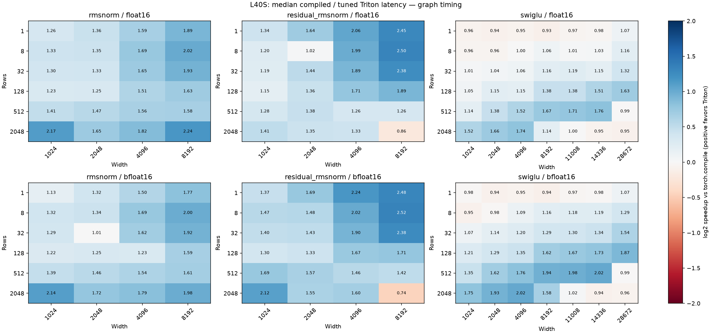
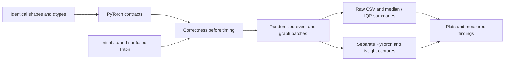

# Transformer Kernel Lab

Three inference-only Triton operators—**RMSNorm**, **residual addition + RMSNorm**, and **SwiGLU**—with a measured study of when fusion helps, when launch tuning helps, and when compiled PyTorch or an unfused implementation wins.

The contribution is the controlled performance comparison and its evidence. These are established operators, not new normalization algorithms. No attention, GEMM, backward, quantization, serving stack, or multi-GPU implementation is included.

## Measured results

On one NVIDIA **L40S**, tuned Triton achieved the following geometric means of per-case **default `torch.compile` median / Triton median** in CUDA Graph replay:

| Operator | Shape/dtype cases | Speedup | Wins / losses beyond 5% |
| --- | ---: | ---: | ---: |
| RMSNorm | 48 | 1.54× | 47 / 0 |
| Residual RMSNorm | 48 | 1.57× | 45 / 2 |
| SwiGLU, realistic intermediate widths | 36 | 1.23× | 22 / 2 |

These are operator measurements across FP16/BF16, not model-level speedups. The compiler uses its default adaptive shape policy. Graph timings can be cache resident; event timings include host-induced GPU idle gaps. Five randomized batches per case are preserved with medians, IQRs, and ranges.



**Fusion is not uniformly faster.** At residual RMSNorm `[2048,8192]` FP16, fused Triton took **181.293 µs**, versus **158.519 µs** unfused and **156.796 µs** compiled PyTorch. Nsight recorded lower L2 traffic for fusion in a separate capture; fewer launches and bytes did not guarantee lower latency. Compiled PyTorch already emits one kernel in every profiled residual/SwiGLU case.

The bounded launch sweep yielded only small normalization gains. For SwiGLU's realistic widths, moving from 256 to 1024 elements per block yielded a **1.34×** geometric-mean initial/tuned ratio; supplementary small cases include regressions. The public API uses the documented default launch settings. The tuned configurations are explicit in the study, rather than hidden in a dispatch system.

- [Concise performance analysis](results/l40s/PERFORMANCE.md)
- [Full performance report and caveats](results/l40s/REPORT.md)
- [Raw samples](results/l40s/raw.csv), [median/IQR table](results/l40s/summary.csv), [comparisons](results/l40s/comparisons.csv)
- [Kernel counts](results/l40s/kernel-counts.csv), [Nsight counters](results/l40s/nsight-metrics.csv), [public profiler traces](results/l40s/traces/)

## Install

GPU execution requires Linux, NVIDIA CUDA, and a compatible driver. The measured environment was Python 3.9.25, PyTorch 2.4.1+cu121, Triton 3.0.0, driver 615.71.09, L40S capability 8.9. macOS is useful for reading results and plotting; it cannot execute this CUDA implementation. The benchmark runner deliberately restricts measurements to L40S to match the published study.

```bash
git clone https://github.com/yixuan-zheng/transformer-kernel-lab.git
cd transformer-kernel-lab
python3.9 -m venv .venv
source .venv/bin/activate
python -m pip install --upgrade pip
python -m pip install torch==2.4.1 --index-url https://download.pytorch.org/whl/cu121
python -m pip install -e .
```

Core dependencies are pinned in `pyproject.toml`. Wheel installation, CPU reference tests and installed FP16/BF16 operators passed validation. A fresh download of the entire CUDA dependency stack has not been tested.

## Use and validate

```python
import torch
from kernels import rmsnorm, residual_rmsnorm, swiglu

x = torch.randn(32, 4096, device="cuda", dtype=torch.bfloat16)
residual = torch.randn_like(x)
weight = torch.ones(4096, device="cuda", dtype=x.dtype)
y = rmsnorm(x, weight)
y, updated_residual = residual_rmsnorm(x, residual, weight)
activation = swiglu(x, residual)
```

Inputs must be contiguous CUDA FP16/BF16 tensors; gradients are rejected. Normalization accepts `[rows,width]`, weights `[width]`, and widths 1–16384. Zero-row inputs are supported. Residual addition rounds to input dtype before normalization, returns both outputs, and mutates neither input. SwiGLU uses FP32 activation/multiply intermediates before casting. See [full contracts](kernels/README.md).

```bash
# CPU reference semantics, run from the checkout
python -m unittest discover -s tests -v
# On an allocated L40S GPU
python -m tests.validate_kernels
# Bounded sweep, interleaved timings, correctness, and traces
tkl-bench --output results/new-run
```

Always use a fresh output directory to preserve evidence. The full study took about 20 minutes after allocation. [Reproduction instructions](docs/REPRODUCIBILITY.md) include the separate Nsight command.

## How it works



Normalization uses one Triton program per row, masked power-of-two blocks and FP32 reduction. Residual fusion writes the required updated residual and normalizes within that launch. SwiGLU fuses elementwise activation and multiplication. [Architecture notes](docs/ARCHITECTURE.md) explain the precision boundaries and traffic accounting.

```text
kernels/                 Three operators and contracts
baselines/               PyTorch numerical references
benchmarks/              Timing, tuning, analysis and reporting
tests/                   Reference tests and GPU correctness matrix
tools/                   Installation and artifact checks
docs/                    Reproduction, architecture and references
results/l40s/            Published samples, tables, plots and counters
results/l40s/traces/     Portable copies of the 12 profiler traces
```

## Evidence and limits

The study audited **8,520 samples**, **1,704 timing groups**, and **12 traces**; no requested case failed correctness or was skipped. GPU correctness covered 288 returned-output comparisons including irregular widths, empty batches, scaled values and input immutability. Large-input FP16 SwiGLU overflow is counted separately from finite errors.

One GPU architecture, one main timing run, unlocked clocks, fixed graph buffers and default compiler settings limit generalization. The profiler did not establish the root cause of the large residual fusion loss. Logical-I/O estimates are not DRAM bandwidth measurements. No serving-library dependency was installed. Installation was checked outside the source tree in an isolated environment inheriting the recorded CUDA dependencies.

Standard Triton reduction/masking patterns informed the implementation. [References and attribution](docs/REFERENCES.md) distinguish consulted sources from original code. MIT licensed.
